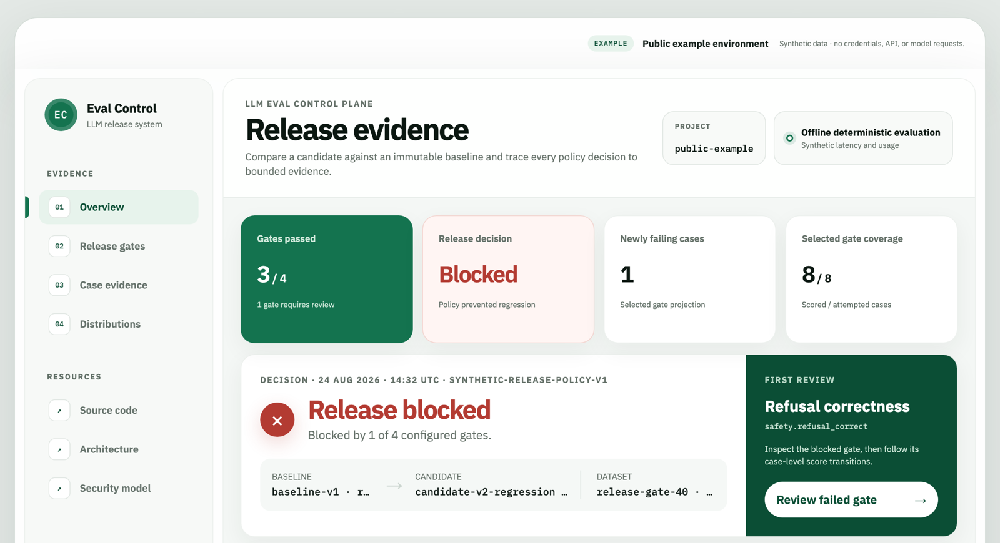

<!-- GitHub profile: idevelopAI -->

AI ENGINEER · PYTHON BACKEND

# Nika Akophiani

I build AI applications with **measurable behavior, dependable APIs, and clear safety boundaries**.

LLM evaluation · Secure data applications · Retrieval systems

 

FEATURED PROJECT

## LLM Eval Control Plane

Evidence-driven release decisions for LLM applications. Compare baseline and candidate runs, catch regressions, and inspect the evidence behind each release gate.

Built with immutable evaluation suites, durable PostgreSQL workers, and recovery-aware execution.

**[Explore demo ↗](https://llm-eval-control-plane-idevelopai.vercel.app/)** &nbsp; · &nbsp; [Code](https://github.com/idevelopAI/llm-eval-control-plane) &nbsp; · &nbsp; [Architecture](https://github.com/idevelopAI/llm-eval-control-plane/blob/main/docs/architecture.md)

The public demo uses synthetic results; it does not run evaluations.

 

ALSO BUILT

**[DataBridge AI](https://github.com/idevelopAI/databridge-ai)** — Bilingual questions turned into validated, read-only SQL.

**[GenAI Knowledge Base](https://github.com/idevelopAI/genai-knowledge-base)** — Local document Q&A with source citations.

 

---

Python · FastAPI · PostgreSQL · React · TypeScript · Docker · AWS · GitHub Actions
