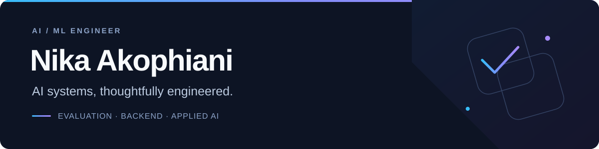

<!-- GitHub profile: idevelopAI -->

  

  <strong>Building useful AI, with the engineering to back it up.</strong> 
  Based in Germany · LLM evaluation · Secure data applications · Retrieval systems

  <a href="https://llm-eval-control-plane-idevelopai.vercel.app/">Explore the demo</a> &nbsp; / &nbsp;
  <a href="#projects">View projects</a> &nbsp; / &nbsp;
  <a href="https://github.com/idevelopAI?tab=repositories">Browse repositories</a>

 

## About me

I’m an **AI/ML engineer** working where AI meets dependable software. I build evaluation infrastructure, secure APIs, and applications that make complex data useful.

My focus: **measurable behavior, clear boundaries, and systems that recover gracefully.**

## Projects

<table>
<tr>
<td colspan="2" valign="top">

<strong>01 &nbsp; / &nbsp; FEATURED · EVALUATION INFRASTRUCTURE</strong>

<h3><a href="https://github.com/idevelopAI/llm-eval-control-plane">LLM Eval Control Plane</a></h3>

<strong>Make every AI release a decision backed by evidence.</strong>

Compare baseline and candidate runs, catch regressions in critical safety and language groups, and inspect the evidence behind each release gate.

Immutable evaluation suites &nbsp; · &nbsp; Durable PostgreSQL workers &nbsp; · &nbsp; Recovery &amp; observability

<code>Python</code> <code>FastAPI</code> <code>PostgreSQL</code> <code>React</code> <code>TypeScript</code>

<a href="https://llm-eval-control-plane-idevelopai.vercel.app/"><strong>Explore demo ↗</strong></a> &nbsp; · &nbsp; <a href="https://github.com/idevelopAI/llm-eval-control-plane">Repository</a> &nbsp; · &nbsp; <a href="https://github.com/idevelopAI/llm-eval-control-plane/blob/main/docs/architecture.md">Architecture</a> The public demo uses synthetic evidence; it does not run evaluations.

</td>
</tr>
<tr>
<td width="50%" valign="top">

<strong>02 &nbsp; / &nbsp; AI + STRUCTURED DATA</strong>

<h3><a href="https://github.com/idevelopAI/databridge-ai">DataBridge AI</a></h3>

<strong>Ask your database. Inspect the answer.</strong>

English and German questions become validated SQL, tables, charts, and exports, with read-only access and independent safety controls.

<code>FastAPI</code> <code>Gemini</code> <code>PostgreSQL</code> <code>SQLGlot</code>

<a href="https://github.com/idevelopAI/databridge-ai"><strong>View project ↗</strong></a> &nbsp; · &nbsp; <a href="https://github.com/idevelopAI/databridge-ai/blob/main/docs/demo.mp4">Walkthrough</a>

</td>
<td width="50%" valign="top">

<strong>03 &nbsp; / &nbsp; RETRIEVAL + KNOWLEDGE</strong>

<h3><a href="https://github.com/idevelopAI/genai-knowledge-base">GenAI Knowledge Base</a></h3>

<strong>From documents to grounded answers.</strong>

A local RAG application for PDF questions, with source citations, relevance filtering, versioned ingestion, and resilient provider handling.

<code>Python</code> <code>LangChain</code> <code>ChromaDB</code> <code>Streamlit</code>

<a href="https://github.com/idevelopAI/genai-knowledge-base"><strong>View project ↗</strong></a> &nbsp; · &nbsp; <a href="https://github.com/idevelopAI/genai-knowledge-base#evaluation">Evaluation</a>

</td>
</tr>
</table>

## Toolkit

**Applied AI** &nbsp; RAG · Text-to-SQL · Deterministic evaluation 
**Engineering** &nbsp; API design · Background jobs · CI/CD · Privacy-aware observability

 

  <strong>Curious about the details? Start with the code.</strong> 
  <a href="https://github.com/idevelopAI?tab=repositories">Explore all public projects ↗</a>

